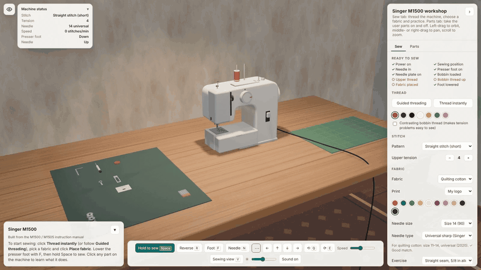
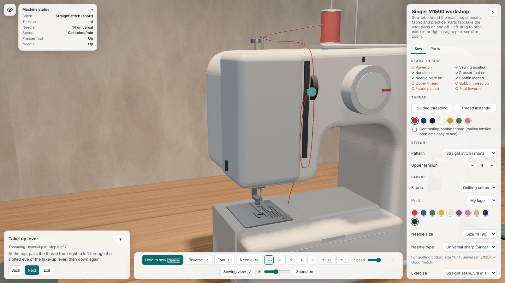
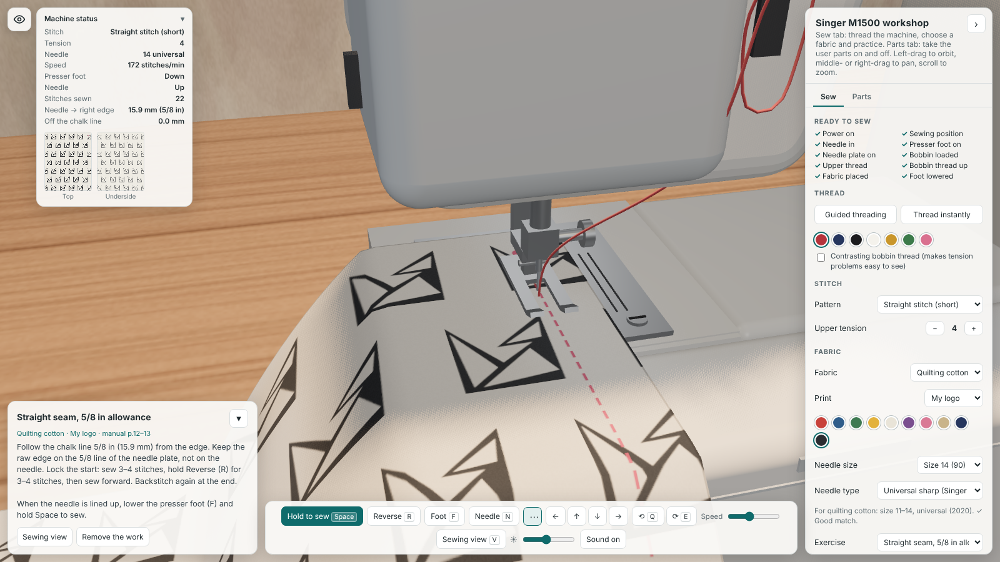
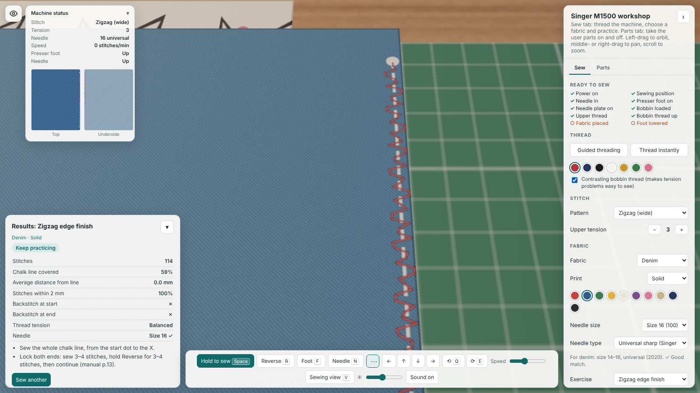
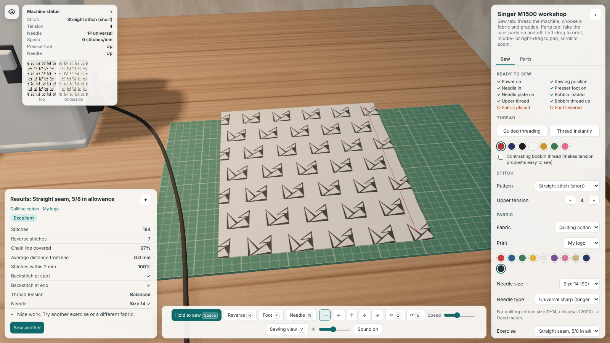
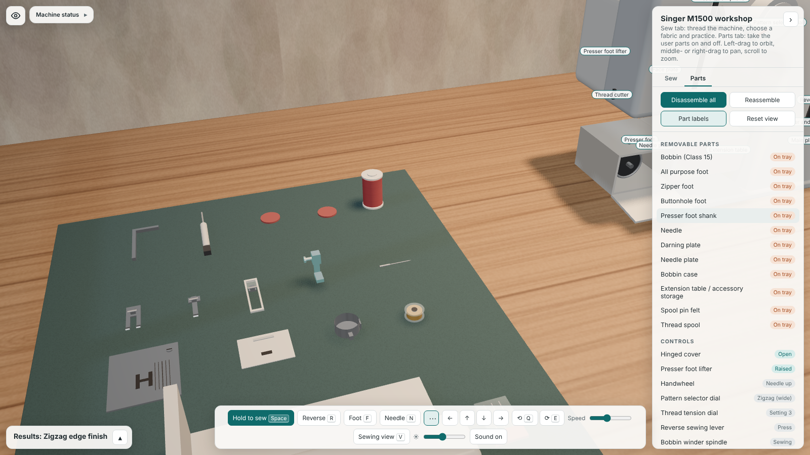
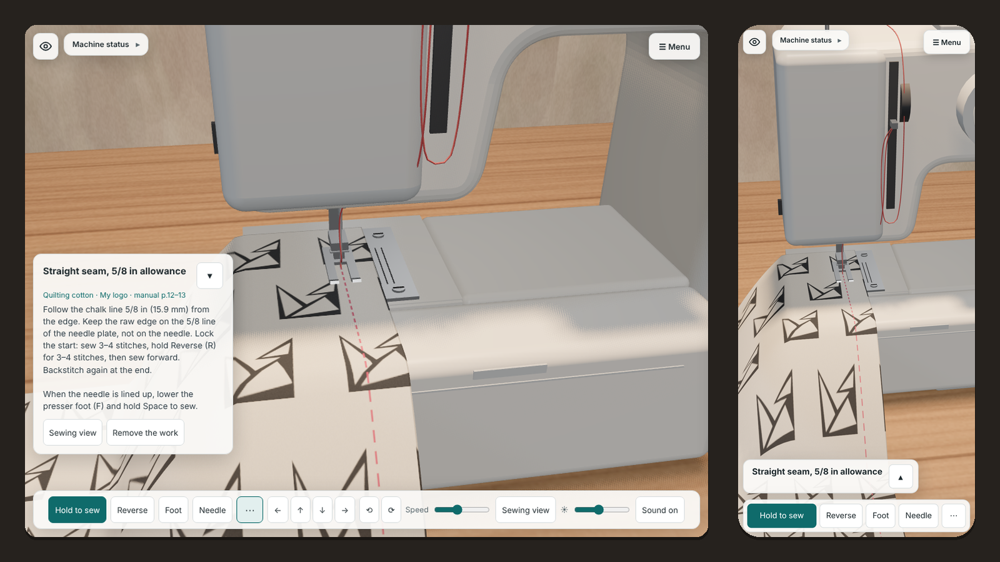

# Sewing Workshop (Singer M1500)

A 3D, browser-based training simulator for a household sewing machine. Take the user parts on and off,
thread it, and sew practice seams on printed fabric, with each step following the Singer M1500 / M1505
instruction manual.

A 51-second tour. [Watch it as an MP4 (higher quality)](docs/media/tour.mp4).

## Screenshots

| | |
|---|---|
|  |  |
| **Threading**: seven guided steps from the manual (p.8–9). The thread is drawn through each guide, the tension channels, the take-up lever and the needle. | **Sewing**: a 5/8 in seam on quilting cotton printed with my logo, under the warm pendant lamp. The status panel shows the stitch, speed, needle-to-edge distance and how far you are off the chalk line. |
|  |  |
| **Stitches**: a wide zigzag edge finish on denim. Every stitch is drawn on the top and on the underside, so tension problems show where they would in real life. | **Results**: each exercise is graded on how much of the line you sewed, how close you stayed, backstitching at both ends, tension and needle choice. |
|  |  |
| **Parts**: every user part comes off in the order the manual describes, and goes back on the same way. | **Phone and tablet**: touch controls, a bottom-sheet menu on phones, and panels that minimize or hide so you can see the machine. |

## Run it
1. Install the one dependency (Three.js) once: `npm install`
2. Double-click `start-workshop.bat` (needs Python), or run `python -m http.server 8124` in this folder,
   then open http://localhost:8124/.

After `npm install`, everything runs offline. To use it on a phone or tablet, open
`http://<your computer's IP>:8124/` on the same Wi-Fi network.

## What it does
- **The machine**: a Singer M1500 built from the manual's diagrams, with each principal part from p.1–2
  labeled. The manual gives no dimensions, so sizes are estimated from the drawings (about 33 × 29 × 13 cm).
- **Parts** (the user parts only, not the inside of the machine): extension table, hinged cover, bobbin
  case, bobbin, presser foot shank, all-purpose / zipper / buttonhole feet, needle, needle plate, darning
  plate, thread spool and spool pin felt. The order is enforced: the extension table comes off before the
  hinged cover opens, the foot comes off before the shank, the case comes out before the bobbin, and so on.
- **Controls that work**: handwheel, presser foot lifter (two heights), pattern selector dial (12
  positions), tension dial (0–9), reverse lever, bobbin winder spindle, power/light switch and foot control.
- **Threading**: guided threading (p.8–9) or "Thread instantly". Taking off the spool, needle or bobbin
  unthreads the matching part, as it would on the real machine.
- **Sewing**: one handwheel turn is one stitch. The feed dogs move the fabric only while the needle is out
  of it, and every dial position sews its real shape: three straight stitch lengths, three zigzag widths,
  multi-step zigzag, blind hem, scallop and the 4-step buttonhole.
- **Fabric**: quilting cotton, voile, flannel, jersey knit, denim and canvas, each with its weave and the
  needle sizes from the manual's chart (p.21). Seven prints in ten colors: my logo (the default, from
  `assets/logo.png`), solid, gingham, polka dots, stripes, plaid and floral. The piece drapes off the edges
  of the machine bed.
- **Mistakes it teaches**:
  - Sewing with the presser foot up makes a thread nest underneath.
  - With no thread or no bobbin, the needle only punches holes.
  - Tension set too low leaves loops on the underside, and too high pulls the bobbin thread to the top.
  - A needle too fine for the fabric, or pulling the fabric while sewing, can break the needle.
  - A sharp needle on knit skips stitches.
  - Turning the stitch dial with the needle down is blocked.
- **Exercises**: a straight 5/8 in seam, a curved seam, square corners with pivoting, a zigzag edge
  finish, and free sewing. Each draws a chalk line on the fabric and grades the result. The last three
  finished pieces stay on the cutting mat; click one to see its results again.
- **Controls**:
  - Mouse: drag to orbit, middle- or right-drag to pan, scroll to zoom.
  - Keyboard: Space is the foot pedal, R reverses, F raises or lowers the foot, N moves the needle up or
    down, arrows guide the fabric and Q/E pivot it.
  - Touch: one finger orbits, two fingers pan and pinch-zoom, and on-screen buttons hold to sew.
  - Every panel can be minimized, or all of them hidden at once.
- **Lighting**: sliders for the room light and the machine's sewing lamp.

The machine cycle is real geometry rather than canned animation. The needle enters the fabric at a fixed
point in each handwheel turn, and feed is spread over the part of the turn when the needle is up. So
stitch spacing, zigzag width and backstitch overlap come out of the simulation.
`npm test` runs two headless checks:
- `test/stitches.test.mjs` sews 40 stitches of every pattern and confirms the spacing and needle
  swing, however finely the handwheel turn is sliced.
- `test/exercises.test.mjs` confirms that every chalk guide fits on the fabric and clears the machine
  arm, and that a seam sewn on the line grades Excellent while an off-line or unfinished one does not.

## Files
- `index.html`, `styles.css`: page and layout.
- `js/app.js`: the machine model, parts, threading, fabric and stitching, and the interface.
- `js/data.js`: fabrics, needles, stitch patterns, the machine cycle, exercises and grading. It has no
  Three.js, so the tests import it directly.
- `assets/logo.png`: the logo print, stored as a transparent mask so it can be tinted to any fabric color.

This is a learning aid, not a replacement for your machine's manual. Settings vary between machines,
so always check your own.
